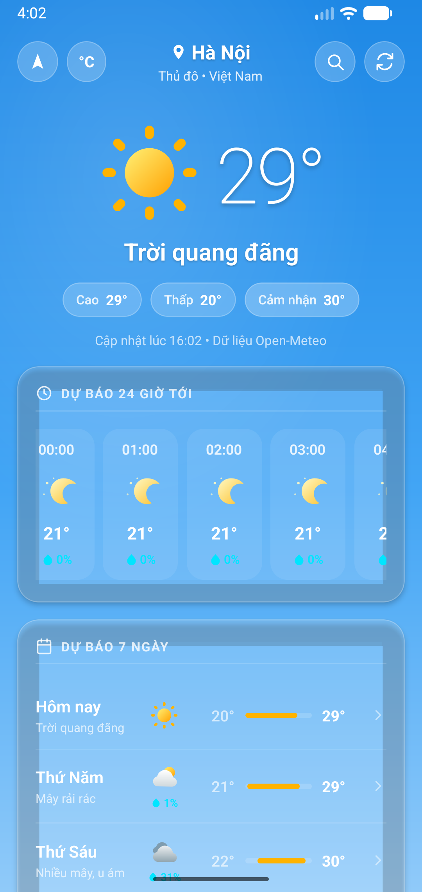

# ⛅ WeatherApp - Ứng Dụng Dự Báo Thời Tiết (React Native)

[](https://reactnative.dev/)
[](https://www.typescriptlang.org/)
[](LICENSE)
[]()

Ứng dụng dự báo thời tiết di động đa nền tảng được xây dựng bằng **React Native** và **TypeScript**. Ứng dụng cung cấp thông tin thời tiết thời gian thực, dự báo 24 giờ tiếp theo và 7 ngày tới với giao diện hiện đại, trực quan, hỗ trợ tự động định vị GPS và tìm kiếm mọi địa điểm trên toàn thế giới.

Dữ liệu thời tiết được cung cấp miễn phí thông qua **Open-Meteo API** (không cần đăng ký hay cấu hình API Key phức tạp).

---

## 📱 Hình Ảnh Ứng Dụng (Screenshots)

<div align="center">
  <table>
    <tr>
      <td align="center"><b>Thời tiết hiện tại</b></td>
      <td align="center"><b>Dự báo 7 ngày & Chỉ số</b></td>
      <td align="center"><b>Tìm kiếm thành phố</b></td>
      <td align="center"><b>Chi tiết địa điểm khác</b></td>
    </tr>
    <tr>
      <td></td>
      <td></td>
      <td></td>
      <td></td>
    </tr>
  </table>
</div>

---

## ✨ Tính Năng Nổi Bật

- 📍 **Tự động định vị GPS**: Lấy vị trí thực tế của người dùng thông qua Geolocation và Reverse Geocoding (chuyển đổi tọa độ sang tên địa phương bằng tiếng Việt).
- 🌡️ **Thời tiết thời gian thực**: Nhiệt độ hiện tại, nhiệt độ cảm nhận (*Feels like*), độ ẩm, chỉ số UV, tầm nhìn, áp suất khí quyển, tốc độ và hướng gió.
- 🕒 **Dự báo 24 giờ tiếp theo (Hourly Forecast)**: Danh sách cuộn ngang theo từng giờ với biểu tượng thời tiết, nhiệt độ và xác suất mưa.
- 📅 **Dự báo 7 ngày (Daily Forecast)**: Cung cấp biên độ nhiệt (Min/Max), xác suất mưa và mô tả trạng thái thời tiết cho từng ngày trong tuần.
- 🔍 **Tìm kiếm địa điểm toàn cầu**: Tìm kiếm nhanh mọi tỉnh/thành phố, hỗ trợ gõ tiếng Việt có dấu/không dấu cùng danh sách gợi ý thành phố phổ biến tại Việt Nam và thế giới.
- 🔄 **Chuyển đổi đơn vị linh hoạt**: Hỗ trợ chuyển đổi nhanh giữa độ C (°C) và độ F (°F) chỉ với 1 chạm.
- 🌅 **Bình minh & Hoàng hôn**: Hiển thị chính xác thời gian mặt trời mọc và lặn trong ngày.
- 🎨 **Giao diện Gradient thích ứng**: Màu nền tự động biến đổi theo trạng thái ngày/đêm và điều kiện thời tiết (nắng ráo, nhiều mây, mưa rào, sương mù, dông bão,...).
- 🔄 **Kéo để làm mới (Pull-to-Refresh)**: Cập nhật dữ liệu thời tiết mới nhất mọi lúc.

---

## 🛠️ Công Nghệ Sử Dụng (Tech Stack)

- **Framework**: [React Native](https://reactnative.dev/) (v0.87.1)
- **Ngôn ngữ**: [TypeScript](https://www.typescriptlang.org/)
- **Navigation**: [React Navigation v7](https://reactnavigation.org/) (Native Stack)
- **Đồ họa & Icon**: [react-native-svg](https://github.com/software-mansion/react-native-svg) với bộ Vector Icons thiết kế tùy biến
- **Định vị vị trí**: [@react-native-community/geolocation](https://github.com/michalchudziak/react-native-geolocation)
- **API Dữ liệu thời tiết**:
  - [Open-Meteo Forecast API](https://open-meteo.com/) (Dữ liệu thời tiết)
  - [Open-Meteo Geocoding API](https://open-meteo.com/en/docs/geocoding-api) (Tìm kiếm địa điểm)
  - [BigDataCloud Reverse Geocoding](https://www.bigdatacloud.com/) & OpenStreetMap Nominatim (Định vị ngược ra tên thành phố)

---

## 📁 Cấu Trúc Thư Mục (Project Structure)

```text
WeatherApp/
├── android/                   # Cấu hình và mã nguồn native Android
├── ios/                       # Cấu hình và mã nguồn native iOS
├── src/
│   ├── api/                   # Gọi API thời tiết và tìm kiếm địa điểm
│   │   ├── geocodingApi.ts    # Tìm kiếm thành phố & Reverse Geocode
│   │   └── weatherApi.ts      # Fetch dữ liệu Open-Meteo (current, hourly, daily)
│   ├── components/            # Các UI component tái sử dụng
│   │   ├── common/            # Component chung (Icon, Card, Loading, Error, Gradient)
│   │   ├── navigation/        # Header thanh tiêu đề tùy biến
│   │   └── weather/           # Component thời tiết (Current, Hourly, Daily, Metrics)
│   ├── navigation/            # Cấu hình điều hướng (RootNavigator)
│   ├── screens/               # Màn hình ứng dụng
│   │   ├── HomeScreen.tsx     # Màn hình thời tiết chính
│   │   ├── DetailScreen.tsx   # Màn hình chi tiết dự báo từng ngày
│   │   └── SearchCityScreen.tsx # Màn hình tìm kiếm thành phố
│   ├── types/                 # Định nghĩa TypeScript Types & Interfaces
│   └── utils/                 # Hàm tiện ích (format ngày giờ, mã WMO, cấp quyền GPS)
├── App.tsx                    # Entry point của ứng dụng
├── generate-autolinking.js    # Script tự động tạo cấu hình autolinking cho Android
├── package.json               # Danh sách thư viện và scripts chạy
└── tsconfig.json              # Cấu hình TypeScript
```

---

## 📋 Yêu Cầu Môi Trường (Prerequisites)

Trước khi cài đặt và chạy ứng dụng, máy tính của bạn cần được cài đặt sẵn:

1. **Node.js**: Phiên bản **>= 18.x** (khuyến nghị Node 20 LTS hoặc Node 22).
   - Kiểm tra bằng lệnh: `node -v`
2. **JDK (Java Development Kit)**: Phiên bản **JDK 17**.
   - Kiểm tra bằng lệnh: `java -version`
3. **Android Studio**:
   - Cài đặt **Android SDK** (Android 14 / API 34 hoặc API 35).
   - Cài đặt **Android SDK Platform-Tools** và **Android SDK Build-Tools**.
   - Thiết lập biến môi trường hệ thống:
     - `ANDROID_HOME = C:\Users\<Tên_User>\AppData\Local\Android\Sdk`
     - Bổ sung vào biến `Path`: `%ANDROID_HOME%\platform-tools`
4. **Thiết bị chạy**:
   - Máy ảo **Android Emulator** (được tạo trong Android Studio AVD Manager), hoặc:
   - **Điện thoại Android thật** đã bật chế độ *USB Debugging (Gỡ lỗi qua USB)*.

---

## 🚀 Hướng Dẫn Cài Đặt & Chạy Ứng Dụng

### Bước 1: Mở thư mục dự án

Mở Terminal / PowerShell và điều hướng vào thư mục `WeatherApp`:

```bash
cd WeatherApp
```

### Bước 2: Cài đặt các gói phụ thuộc (Dependencies)

Chạy lệnh cài đặt thư viện:

```bash
npm install
```

> 💡 **Mẹo cho Windows PowerShell**: Nếu gặp lỗi `npm.ps1 cannot be loaded because running scripts is disabled`, bạn có thể dùng lệnh `npm.cmd install` hoặc mở PowerShell quyền Admin và chạy:
> ```powershell
> Set-ExecutionPolicy -Scope CurrentUser -ExecutionPolicy RemoteSigned
> ```

---

### Bước 3: Khởi động máy ảo hoặc kết nối thiết bị

1. Mở máy ảo Android trong Android Studio (hoặc kết nối điện thoại Android qua cáp USB).
2. Kiểm tra thiết bị đã sẵn sàng bằng lệnh:

```bash
adb devices
```

*Nếu thấy xuất hiện thiết bị (ví dụ: `emulator-5554 device`), tức là đã kết nối thành công.*

---

### Bước 4: Khởi động Metro Bundler

Mở một cửa sổ dòng lệnh tại thư mục `WeatherApp` và chạy:

```bash
npm start
```
*(hoặc `npm.cmd start`)*

---

### Bước 5: Build và chạy ứng dụng trên Android

Mở một cửa sổ dòng lệnh thứ hai (hoặc chạy trực tiếp) lệnh:

```bash
npm run android
```
*(hoặc `npm.cmd run android`)*

> ⚙️ **Cơ chế tự động**: Lệnh `npm run android` sẽ tự động thực thi script tiền xử lý `preandroid: node generate-autolinking.js` để tạo file cấu hình autolinking, sau đó biên dịch Gradle và cài đặt file APK lên thiết bị của bạn.

Sau khi quá trình build hoàn tất (khoảng 1 - 3 phút ở lần build đầu tiên), ứng dụng sẽ tự động mở trên máy ảo hoặc thiết bị thực của bạn!

---

## ❓ Xử Lý Sự Cố Thường Gặp (Troubleshooting)

### 1. Lỗi PowerShell không cho chạy file script (`.ps1`)
- **Triệu chứng**: `File C:\nvm4w\nodejs\npm.ps1 cannot be loaded because running scripts is disabled on this system.`
- **Khắc phục**:
  - Cách 1: Sử dụng tiền tố `.cmd`, ví dụ: `npm.cmd install`, `npm.cmd start`, `npm.cmd run android`.
  - Cách 2: Mở PowerShell và cấp quyền thực thi script:
    ```powershell
    Set-ExecutionPolicy -Scope CurrentUser -ExecutionPolicy RemoteSigned
    ```

### 2. Lỗi `No connected devices!` hoặc không tìm thấy thiết bị
- **Khắc phục**:
  - Đảm bảo máy ảo Android đã được khởi động xong trước khi chạy `npm run android`.
  - Nếu dùng điện thoại thật: Kiểm tra cáp USB, bật *Tùy chọn cho nhà phát triển* -> *Gỡ lỗi USB*, và đồng ý cấp quyền khi điện thoại hiện hộp thoại hỏi xác nhận.
  - Chạy `adb devices` để kiểm tra trạng thái thiết bị.

### 3. Cổng Metro 8081 bị chiếm dụng
- **Triệu chứng**: `Port 8081 is already in use by another process.`
- **Khắc phục**: Chạy Metro trên cổng khác:
  ```bash
  npx react-native start --port 8088
  ```

### 4. Xóa bộ nhớ cache và build sạch (Clean Build)
- Khi gặp các lỗi liên quan đến cache thư viện hoặc Gradle:
  ```bash
  # Xóa cache Metro:
  npx react-native start --reset-cache

  # Clean build Android:
  cd android
  ./gradlew clean
  cd ..
  npm run android
  ```

### 5. Cấp quyền vị trí (GPS Permission)
- Ứng dụng sẽ hiển thị hộp thoại yêu cầu quyền vị trí khi mở lần đầu. Vui lòng chọn **"Khi dùng ứng dụng"** (*While using the app*).
- Nếu bạn từ chối quyền hoặc đang dùng máy ảo chưa bật GPS, ứng dụng sẽ tự động tải thời tiết mặc định tại **Hà Nội**. Bạn có thể dùng thanh tìm kiếm để chọn bất kỳ tỉnh/thành phố nào mong muốn.

---

## 📜 Giấy Phép & Bản Quyền

Dự án được phân phối theo giấy phép MIT License. Thoải mái tham khảo, sửa đổi và phát triển cho mục đích học tập và nghiên cứu.
